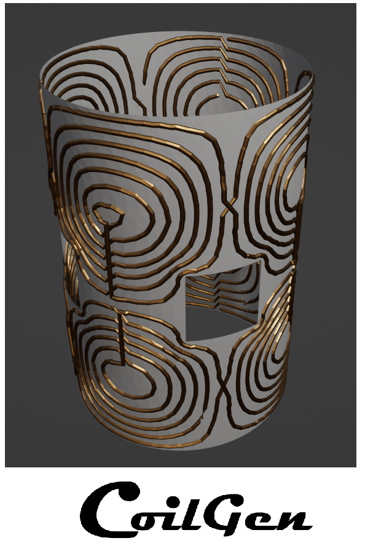
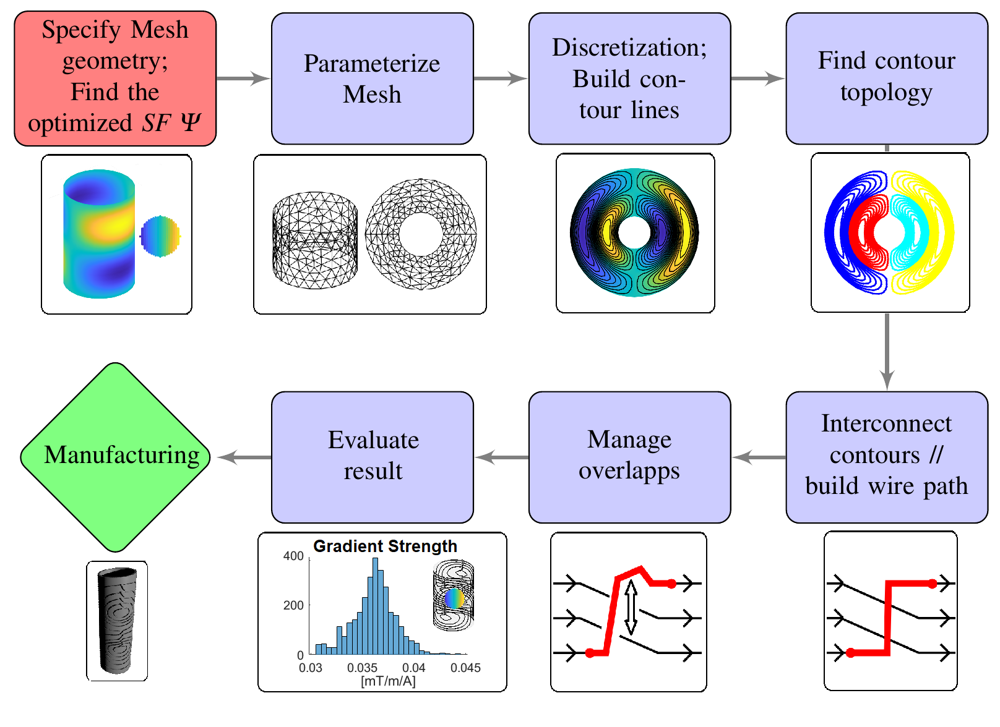

# CoilGen2 is here — the future of CoilGen

> [!IMPORTANT]
> **[CoilGen2](https://github.com/Philipp-MR/Coilgen2) is the new, substantially improved successor to CoilGen and the recommended starting point for all new coil-design projects.**
>
> Future development takes place in **CoilGen2**. The original MATLAB version in this repository is no longer maintained and remains available for reference and reproduction of earlier work.
>
> **[→ Get started with CoilGen2](https://github.com/Philipp-MR/Coilgen2)**

## Why move to CoilGen2?

CoilGen2 builds on the original CoilGen method and substantially expands the tools available for designing, analyzing, and refining coil winding patterns.

- **Python API and desktop workbench:** Work through a class-based scripting interface or a native graphical application with interactive 3D visualization, editable projects, and design templates.
- **Expanded optimization capabilities:** Explore power, magnetic-energy, and current-density objectives with constrained field optimization and additional engineering constraints.
- **Flexible geometry and target fields:** Use generated support surfaces, imported STL meshes, analytical target fields, or imported field maps.
- **Intrinsic mesh topology:** Process contour topology directly on the triangular support surface without requiring a global surface flattening.
- **Richer engineering analysis:** Evaluate field errors, current requirements, resistance and inductance estimates, routing, and conductor geometry.
- **Manufacturing-oriented outputs:** Generate swept conductor geometries, STL exports, and cylindrical PCB artwork, with accompanying geometry and clearance diagnostics.

**For new gradient, shim, and magnetostatic coil-design projects, start with CoilGen2.**

### Get started with CoilGen2

**[CoilGen2 repository](https://github.com/Philipp-MR/Coilgen2)** ·
[Installation](https://github.com/Philipp-MR/Coilgen2/blob/main/docs/INSTALL.md) ·
[Getting started](https://github.com/Philipp-MR/Coilgen2/blob/main/docs/GETTING_STARTED.md) ·
[Desktop workbench](https://github.com/Philipp-MR/Coilgen2/blob/main/docs/NATIVE_WORKBENCH.md) ·
[Examples](https://github.com/Philipp-MR/Coilgen2/blob/main/docs/EXAMPLES.md)

---

# CoilGen — original MATLAB version

CoilGen is an open-source tool for generating coil winding patterns for MRI/NMR and magnetostatic field shaping.

Starting from a target magnetic field and a triangular support-surface mesh, CoilGen uses a boundary-element stream-function method to optimize a surface-current distribution and convert its contours into interconnected wire paths.

For example, a target of `Bz(x,y,z) = G·y`, where `G` is the desired gradient strength, defines a linear variation of the longitudinal magnetic field along the y direction. The support surface can be supplied as an STL mesh.

The original method and postprocessing workflow are described in the [CoilGen publication](https://doi.org/10.1002/mrm.29294).

## Using the legacy MATLAB code

This version remains available for existing workflows and reproduction of published results.

1. Download or clone this repository.
2. Open it in **MATLAB R2020a or newer**.
3. Run an example from the [`Examples`](./Examples) folder.
4. Adapt the target field, support geometry, and design parameters as needed.

**FastHenry2** is optional for the legacy inductance calculation. See the [`Documentation`](./Documentation) folder for the original documentation.

When reproducing earlier results, retain the exact code revision, MATLAB version, input geometry, and parameter settings. CoilGen2 has its own implementation and should not be assumed to reproduce legacy results identically.

**Legacy plotting correction:** A field-scale correction was made in `plot_various_error_metrics`. Use a revision containing that fix when evaluating legacy plots.

### Original algorithm overview

## Related project: pyCoilGen

The original author also supported **pyCoilGen**, a separate Python translation of the original MATLAB CoilGen project.

- [pyCoilGen source code](https://github.com/kev-m/pyCoilGen)
- [pyCoilGen documentation](https://pycoilgen.readthedocs.io/)

**CoilGen2 is the successor developed and maintained by Philipp Amrein and the focus of future CoilGen development.**

## Citation

When using CoilGen, please cite:

> Amrein P, Jia F, Zaitsev M, Littin S. **CoilGen: Open-source MR coil layout generator.** *Magnetic Resonance in Medicine.* 2022;88(3):1465–1479.
> [doi:10.1002/mrm.29294](https://doi.org/10.1002/mrm.29294)

When using CoilGen2, also record the software version or commit used to support reproducibility.

## License

See [LICENSE.txt](./LICENSE.txt) for the license of this repository.

## Contact

**Philipp Amrein** · [GitHub](https://github.com/Philipp-MR)

**Continue with [CoilGen2 — the next generation of CoilGen](https://github.com/Philipp-MR/Coilgen2).**
